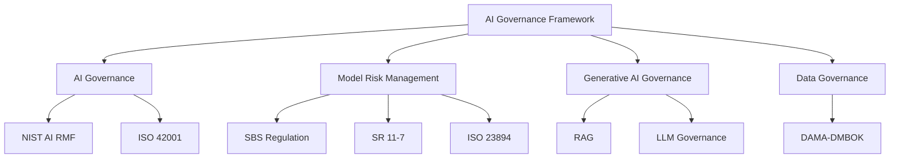

# AI Governance Framework for Financial Services

Framework de referencia para el gobierno de Inteligencia Artificial en instituciones financieras, integrando AI Governance, Model Risk Management (MRM), Generative AI y Data Governance.

## Domains

- AI Governance
- Model Risk Management
- Responsible AI
- Generative AI
- Data Governance

## Framework Overview



## Repository Structure

```text
ai-governance-framework/
│
├── policy/
├── standards/
├── controls/
├── risk-assessment/
├── model-inventory/
├── operating-model/
├── regulations/
│   ├── peru/
│   └── international/
└── examples/
```

## Regulatory References

### Peru

- SBS - Gestión de Riesgo de Modelos
- Ley de Inteligencia Artificial
- Marco Nacional de Confianza Digital
- Protección de Datos Personales

### International

- NIST AI Risk Management Framework
- ISO/IEC 42001
- ISO 23894
- SR 11-7
- DAMA-DMBOK

## Scope

Este repositorio proporciona plantillas, estándares, controles y artefactos de gobierno para:

- Machine Learning Models
- Generative AI Systems
- Large Language Models (LLM)
- Retrieval-Augmented Generation (RAG)
- Financial Services AI Use Cases
```